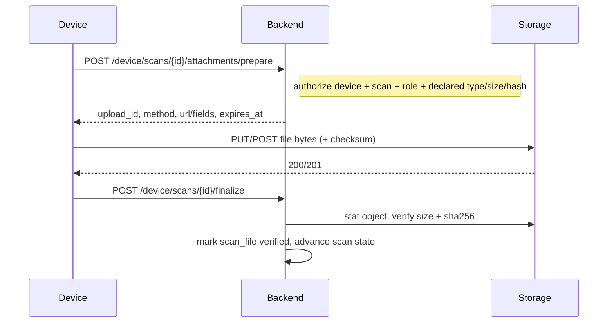

# File Storage Architecture — Rice Age Portal

**Status:** Phase 1 design. File types, limits and mandatory attachments are **not**
confirmed by stakeholders; configurable provisional local-development limits are used
until they are (DR-005, DR-006, DR-007).

---

## 1. Scope

The portal stores, for each accepted scan:

| Role | Content | Availability |
| --- | --- | --- |
| `report_pdf` | Original device-generated analysis PDF (byte-identical) | "Where required by device capability"; SOR implies it is the primary downloadable report |
| `bottom_image` | Primary / bottom platen optical capture | Expected for every scan |
| `top_image` | Secondary / top verification optical capture | Only where the device produces it |
| `other` | Any additional approved attachment | Future; requires stakeholder approval per type |

The portal never regenerates, re-renders, or edits these files. It stores them and
controls access.

---

## 2. Storage abstraction

```python
# backend/app/storage/base.py (shape, not final code)
class StoragePort(Protocol):
    def build_key(self, *, scan_id: UUID, role: FileRole, filename: str) -> str: ...
    def put_object(self, key: str, data: BinaryIO, *, content_type: str,
                   size_bytes: int, sha256: str) -> None: ...
    def open_object(self, key: str) -> BinaryIO: ...
    def stat_object(self, key: str) -> ObjectStat: ...
    def delete_object(self, key: str) -> None: ...
    def create_download_url(self, key: str, *, expires_in: int) -> str: ...
```

Adapters:

| Adapter | Environment | Behaviour |
| --- | --- | --- |
| `LocalStorageAdapter` | Development, tests | Writes under `STORAGE_LOCAL_ROOT` (default `./storage`), outside the web root, never served by a static handler. Download URLs point at an authenticated backend route that streams the file. |
| `S3StorageAdapter` | Production | Private bucket, SSE enabled, versioning where available, short-lived presigned GET. |

Both adapters must expose the same contract so no service code branches on backend.
A third "memory" adapter is used in tests.

Configuration keys (see `.env.example`):

```text
STORAGE_BACKEND=local|s3
STORAGE_LOCAL_ROOT=./storage
STORAGE_S3_ENDPOINT=
STORAGE_S3_REGION=
STORAGE_S3_BUCKET=
STORAGE_S3_ACCESS_KEY_ID=
STORAGE_S3_SECRET_ACCESS_KEY=
STORAGE_S3_USE_PATH_STYLE=true
STORAGE_SIGNED_URL_TTL_SECONDS=300
```

---

## 3. Storage keys

Keys are opaque, deterministic and never derived from user-supplied paths:

```text
scans/{department_id}/{scan_id}/{role}/{file_id}.{ext}
staging/{device_id}/{scan_id}/{role}/{upload_id}.part
```

Rules:

- `role` is the enum value, not a client string.
- `file_id` is a server-generated UUID; the original filename is stored as metadata
  only and never used in the key.
- Extension is chosen by the server from a validated MIME type, not from the client.
- Keys must not contain sample IDs, batch codes or other business identifiers that
  could leak between departments.
- Department appears in the key for operational clarity (lifecycle rules), **not** as
  an access-control mechanism.

---

## 4. Upload flow

### 4.1 Two-step prepared upload (device)



- `prepare` is idempotent per `(scan_id, role)`: re-preparing an unverified role
  returns a fresh upload target and supersedes the previous `upload_attempt`.
- In production the device uploads directly to object storage with a presigned URL
  bound to key, content type, size and short expiry. In development the backend
  exposes an authenticated `PUT /api/v1/device/scans/{id}/files/{upload_id}` route so
  no object store is required.
- `finalize` is idempotent: repeating it on a `Completed` scan returns the current
  state instead of reprocessing files or re-emitting notifications.

### 4.2 Verification on finalize

1. Object exists at the expected key.
2. Byte size equals the declared size and is within the configured limit.
3. SHA-256 matches the client-declared hash (when supplied) and is stored.
4. MIME type detected from magic bytes matches the declared type for the role.
5. Required roles present per policy (`report_pdf` requirement pending DR-007).
6. Rows move from `pending` → `verified`; failed rows record a diagnostic code.

Any failure leaves the scan in `Failed` or `Verifying` (retryable) — never
`Completed` — and emits a technical notification, not a quality verdict.

---

## 5. File metadata (stored in PostgreSQL, not in the object store)

| Field | Notes |
| --- | --- |
| `id` | UUID |
| `scan_id` | FK, cascade on scan deletion policy |
| `role` | `report_pdf` / `bottom_image` / `top_image` / `other` |
| `storage_backend` | `local` / `s3` (recorded for migration traceability) |
| `storage_key` | Unique, opaque |
| `original_filename` | Sanitised for display only |
| `mime_type` | Server-validated |
| `size_bytes` | Bigint |
| `sha256` | 64 hex chars |
| `width_px`, `height_px` | Images only, when extractable |
| `upload_status` | `pending` / `uploaded` / `verified` / `rejected` |
| `verified_at`, `created_at` | Timestamps |

Databases never store public URLs, presigned URLs, or object-store credentials.

---

## 6. Validation rules

| Check | Rule | Status |
| --- | --- | --- |
| Declared content type | Must be in the per-role allowlist | Allowlist finalisation pending DR-006 |
| Magic bytes | Must match the declared type (`%PDF-`, `image/jpeg` SOI, `image/png` signature) | Required |
| Size | Per-role configurable limit, provisional local dev: PDF 25 MiB, images 15 MiB | Pending DR-005 |
| Checksum | SHA-256 required on prepare for device uploads | Required |
| Dimensions | Images: minimum 320 px on each side, maximum 12000 px | Provisional |
| Filename | Strip path separators, control chars, leading dots; cap at 200 chars | Required |
| Duplicate role | At most one active file per fixed role per scan | Required |
| Malware | Optional external scan hook before `verified` | Deferred; decision pending |

Provisional limits live in configuration, not constants, and are labelled
`PROVISIONAL` in `.env.example`.

---

## 7. Access control

- No bucket, directory or object is publicly readable. Static file serving of the
  storage root is forbidden.
- Every download goes through the API:
  1. Authenticate the principal.
  2. Load the scan, verify the caller's department equals the scan snapshot (or the
     caller is an authorized super admin).
  3. Verify `scan.processing_status == completed` and file `upload_status == verified`.
  4. Issue a short-lived URL or stream the bytes.
- Super-admin cross-department downloads are audited with scan, file, actor and
  reason.
- `Content-Disposition: attachment; filename="<safe original name>"`; PDFs render
  with `Content-Type: application/pdf`, images with their validated type.
- No cacheable responses for private files (`Cache-Control: private, no-store`).
- Range requests for PDF preview are supported by the backend stream, not by exposing
  the object store.

---

## 8. Retention, cleanup and failure handling

| Concern | Approach |
| --- | --- |
| Incomplete uploads | `staging/` objects expire after `UPLOAD_STAGING_TTL_HOURS` (default 24) via a scheduled cleanup; scans left `AwaitingFiles` past the TTL move to `Failed` with a diagnostic code |
| Orphan files | Files with no verified DB row are deleted after the staging TTL |
| Scan deletion | Not exposed in Phase 1. If introduced, delete DB row in a transaction, then objects; never the reverse |
| Retention period | Pending DR-013; no automatic deletion is implemented until then |
| Legal hold | Not modelled; revisit with retention decision |
| Failed uploads | Recorded in `upload_attempts` with diagnostic codes; retry reuses the same scan via idempotency |
| Backups | Object store versioning/lifecycle in production; local dev storage is disposable |

Deletion of a scan record is a deliberate, audited administrative action in a future
phase; no cascade from device or department deletion is permitted while scans exist.

---

## 9. Migration between backends

`storage_backend` is recorded per file so records remain valid if the platform moves
from local to S3. A migration copies objects key-to-key, verifies SHA-256, updates
`storage_backend`, and only then removes sources. Because keys are backend-agnostic,
no schema change is required.
