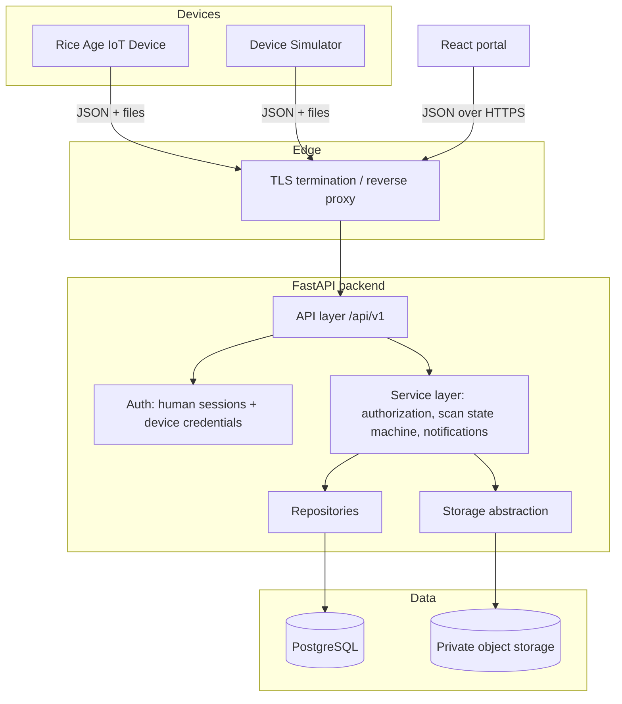
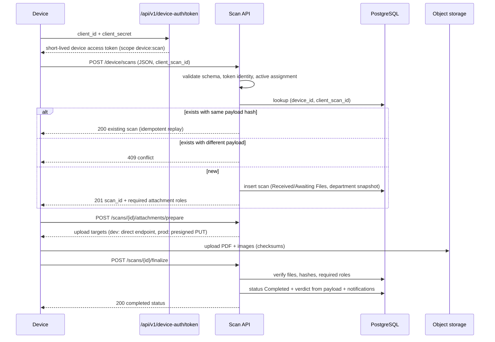
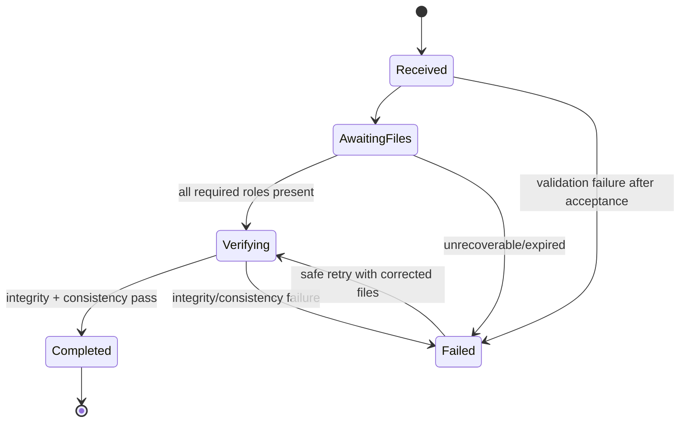

# System Architecture — Rice Age Portal

**Status:** Phase 1 design baseline. Decisions still open are tracked in
`docs/decisions/DECISION_REGISTER.md`; nothing here overrides the PRD/SOR.

---

## 1. Architectural goals

| Goal | How the architecture serves it |
| --- | --- |
| Department isolation by construction | Single backend, department resolved from the authenticated principal, scope applied in the service layer, department snapshots stored on records |
| Trustworthy ingestion | Device-specific credentials, schema validation, idempotency, attachment verification, explicit scan state machine |
| Faithful data presentation | Normalised measurements keyed by metric + basis, raw payload retention, original PDF stored byte-for-byte |
| Operability by a small team | One backend service, one database, one object store; no premature microservices or brokers |
| Reproducible delivery | Docker Compose development stack, environment-based configuration, CI, migrations |
| Replaceable boundaries | Storage adapter abstraction, repository layer, versioned API contracts |

---

## 2. Technology decisions

### 2.1 Frontend

| Technology | Responsibility | Why selected | Alternatives considered | Limitations |
| --- | --- | --- | --- | --- |
| React 19 | Component model for the portal | Required by the project brief; mature ecosystem; institutional dashboard fit | Vue, Svelte, Angular | Client-side rendering only for now; bundle discipline required |
| TypeScript | Type safety across API contracts and UI | Catches contract drift at build time; supports shared types | JavaScript | Adds build complexity |
| Vite | Dev server and production bundling | Fast HMR, small config surface, first-class TS | Next.js, Webpack | No SSR (not needed for an authenticated internal portal) |
| Tailwind CSS | Utility styling and design tokens | Consistent density/theming for data-heavy screens | CSS Modules, MUI | Requires discipline via shared tokens and primitives |
| shadcn/ui | Accessible component source, copied in-repo | Owned code, no runtime dependency lock-in, Tailwind-native | MUI, Ant Design, Chakra | Introduced with the first real component; not yet vendored |
| React Router | Client routing and nested role-aware layouts | Standard, supports route guards and lazy loading | TanStack Router | Guards are UX-only; server enforces access |
| TanStack Query | Server-state fetching, caching, polling | Handles stale/refetch states for "latest scan" and history | SWR, Redux Toolkit Query, manual fetch | Not for form/UI state |
| Recharts | Quality and age charts | Composable, works well with measured containers | ECharts, Chart.js | Accessibility of charts requires explicit summaries |
| React Hook Form | Form state for admin/filter forms | Minimal re-renders, good DX | Formik | — |
| Zod | Runtime validation at boundaries | Rejects malformed API payloads; pairs with forms | Yup, io-ts | Schemas must be kept in sync with backend contracts |
| Lucide | Icons | Consistent, tree-shakeable | Font Awesome | — |

Rationale for deferrals:
- **No global state library** until a cross-cutting client state need appears
  (server state belongs to TanStack Query; auth context is small).
- **No SSR framework** — the portal is authenticated, internal, and does not need
  SEO or public content.
- **No charting on day one** — charts arrive with the analytics module in Phase 2+.

### 2.2 Backend

| Technology | Responsibility | Why selected | Alternatives considered | Limitations |
| --- | --- | --- | --- | --- |
| Python 3.12+ | Runtime | Brief requirement; strong data/imaging ecosystem for future pipelines | Node, Go, Java | GIL for CPU-bound work → offload to workers only when justified |
| FastAPI | HTTP API, dependency injection, OpenAPI | Typed, async-capable, Pydantic-native, fast to build | Django REST, Flask | Async requires discipline with blocking DB drivers |
| Pydantic v2 | Schemas, settings, validation | Single source of truth for request/response and config validation | Marshmallow, dataclasses | V1→V2 differences must be avoided |
| SQLAlchemy 2.0 | ORM and query layer | Typed mappings, transactions, portable tests | Django ORM, raw SQL | ORM misuse can hide N+1 queries |
| Alembic | Schema migrations | Standard with SQLAlchemy; reviewable revisions | Django migrations, Atlas | Must never rewrite applied revisions |
| PostgreSQL | Relational store | Constraints, partial unique indexes, JSONB, `TIMESTAMPTZ`, strong integrity | MySQL, SQLite (tests only) | Operational ownership required in production |
| Pytest | Test framework | Standard, expressive fixtures | unittest | — |

### 2.3 Infrastructure

| Technology | Responsibility | Notes |
| --- | --- | --- |
| Docker / Docker Compose | Reproducible dev stack: PostgreSQL + backend + frontend | Production images reuse the same Dockerfiles |
| Environment-based config | All wiring via environment variables | `.env.example` holds placeholders only |
| Local filesystem storage adapter | Development file persistence | Mirrors the object-store contract |
| Private S3-compatible object storage | Production PDF/image storage | Endpoint/region/bucket configurable; no public ACLs |

**Deliberately excluded:** Redis, Celery, message brokers, search clusters,
Kubernetes. Each needs a demonstrated requirement (e.g. measured need for async
notification fan-out or scheduled aggregation) and a decision record.

---

## 3. Component view



Single backend service, stateless between requests (sessions are stored in
PostgreSQL), which keeps horizontal scaling trivial and avoids a broker.

---

## 4. Backend layering

```text
api/            HTTP only: routing, dependencies, status codes, response mapping
  └── services/ Business rules: department scoping, scan lifecycle, notifications
        └── repositories/ Query and persistence; no business decisions
              └── models/ ORM mappings
core/           Settings, logging, shared errors, time utilities
security/       Password hashing, JWT issuance/validation, device credential checks
storage/        StoragePort interface + LocalStorageAdapter + S3 adapter (production)
schemas/        Pydantic models for requests, responses and the device payload
```

Rules:

- A route never builds SQL and never decides authorization.
- A service never returns ORM objects to the API layer; it returns domain data or
  Pydantic models.
- Every department-scoped service function takes the resolved `Principal` and applies
  scope itself, so future callers (workers, admin tooling) cannot bypass it.

### 4.1 Authorization resolution

```text
Bearer access token
   ├── human  → user_id, is_super_admin, memberships[department_id → role]
   └── device → device_id, active assignment department_id (loaded server-side)
Department context = active department of the principal (or explicit super-admin
cross-department parameter, which is authorized and audited).
```

---

## 5. Key data flows

### 5.1 Device scan ingestion



Department ownership is taken from the device's active `device_assignments` row at
acceptance and written to `scans.department_id`. The payload's `device_id`, if
present, must equal the token's device. Payload department values are ignored.

### 5.2 Portal read path

1. User authenticates → access token (short-lived) + rotating refresh session.
2. Every request resolves the principal and its department membership.
3. Service composes a scoped query (`WHERE department_id = :caller_department`).
4. Response returns only fields the role may see.
5. Super-admin cross-department reads require an explicit `department_id` and are
   audited.

### 5.3 Report download

1. `GET /scans/{id}/report` → service loads the scan, checks department scope and the
   `report_pdf` attachment is `verified`.
2. Backend issues a short-lived signed URL (or streams the bytes from the local
   adapter in development).
3. Object storage never serves a public object; keys are opaque and unguessable.

### 5.4 Device reassignment

1. Super Admin closes the current assignment (`effective_to = now()`) and inserts a
   new one in the same transaction.
2. Previous scans keep their `department_id`; nothing is rewritten.
3. Audit log records actor, device, old department, new department, timestamp.
4. In-flight submissions: accepted scans stay with the department captured at
   acceptance; the device must re-authenticate against its current assignment.

---

## 6. Scan lifecycle



- `Completed` is the only state eligible for the latest-scan view, history,
  analytics, comparison and report access.
- `quality_verdict` is a separate nullable column populated from the device's
  evaluation. It is never derived by the portal.
- Transitions are recorded; illegal transitions raise and are logged.

---

## 7. Environments

| Aspect | Development | Production |
| --- | --- | --- |
| Run mode | Docker Compose (or local processes) | Containerised backend + static frontend build behind TLS |
| Database | PostgreSQL container, disposable volume | Managed PostgreSQL, encrypted, backed up |
| Storage | Local filesystem adapter under `./storage` | Private S3-compatible bucket, server-side encryption |
| Config | `.env` from `.env.example` | Secret manager / platform env; no `.env` in images |
| Auth secrets | Generated development values | Rotated secrets, separate per environment |
| Debug/OpenAPI | Enabled | OpenAPI restricted; debug off |
| Logging | Human-readable console | Structured JSON with request IDs |
| Mail/notifications | In-portal only | In-portal first; email provider pending decision |
| Frontend | Vite dev server with proxy | Static bundle served by CDN/reverse proxy |

Config precedence: environment variables → `.env` file (development only) → typed
defaults for non-secret values. Secrets have no defaults.

---

## 8. Non-functional targets (provisional)

| Concern | Baseline | Status |
| --- | --- | --- |
| Portal API latency | p95 < 500 ms for scoped list/detail reads | Provisional until scan volume is known |
| Latest-scan freshness | ≤ 10 s after completion (polling), SSE later if needed | PRD requires automatic update |
| History paging | 25 default, 100 max page size | Provisional |
| Upload resilience | Per-file retry; finalize is idempotent | Required |
| Availability | Single-region MVP, business hours priority | Pending stakeholder decision |
| Retention | Configurable; exact period pending (DR-013) | Blocked on decision |
| Backups | Nightly encrypted backup + restore drill | Frequency/RPO pending (DR-014, DR-015) |

No performance claim is made until device volume and network capacity are supplied.

---

## 9. Known limitations and deferred work

1. **Device contract is provisional** — field names, auth mechanism, file types and
   limits await the firmware team (DR-004, DR-005, DR-006).
2. **Age semantics unconfirmed** — range/category/proportion representation is
   modelled generically; interpretation is deferred (DR-001…DR-003).
3. **Verdicts are opaque** — the portal stores and displays supplied statuses only; no
   rule engine is implemented (DR-008, DR-009).
4. **No realtime transport yet** — polling is the baseline; SSE/WebSocket is added
   only if freshness targets demand it.
5. **No async job system** — notification fan-out and thumbnail generation run inline
   until volume justifies a worker and broker.
6. **No email channel** — provider undecided (DR-012).
7. **Deployment target open** — cloud vs on-prem affects storage, secrets and backup
   design (DR-010).

---

## 10. Related documents

- `docs/architecture/FRONTEND_ARCHITECTURE.md`
- `docs/architecture/FILE_STORAGE_ARCHITECTURE.md`
- `docs/database/DATABASE_SCHEMA.md`
- `docs/api/API_CONTRACT.md`
- `docs/security/SECURITY_ARCHITECTURE.md`
- `docs/decisions/DECISION_REGISTER.md`
