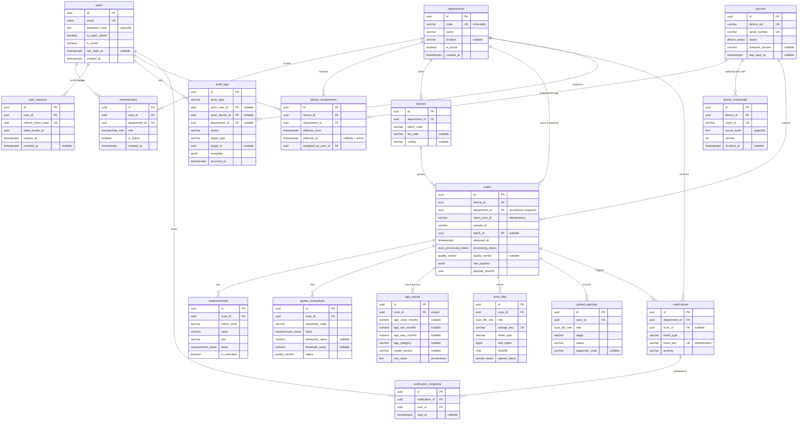

# Entity–Relationship Diagram — Rice Age Portal

**Status:** Phase 1 logical model. No migration is implemented yet; see
`DATABASE_SCHEMA.md` for column-level detail and `DECISION_REGISTER.md` for open
questions. The model is designed so that unresolved decisions (age shape, file limits,
verdict rules) change behaviour, not table structure.

---

## 1. Model overview

Seventeen tables in five groups:

| Group | Tables |
| --- | --- |
| Organisation | `departments`, `users`, `memberships` |
| Identity & devices | `user_sessions`, `devices`, `device_credentials`, `device_assignments` |
| Analysis | `batches`, `scans`, `measurements`, `quality_evaluations`, `age_results` |
| Files | `scan_files`, `upload_attempts` |
| Communication & audit | `notifications`, `notification_recipients`, `audit_logs` |

---

## 2. Diagram

> The mermaid renderer shows `age_results` as `||--|{`; the real cardinality is
> **zero or one age result per scan** (`scans ||--o| age_results`). The unique
> constraint on `age_results.scan_id` enforces it.

---

## 3. Relationship rules and cardinalities

| Relationship | Cardinality | Rule |
| --- | --- | --- |
| `users` – `memberships` – `departments` | M:N via memberships | One membership row per user per department; role is `department_admin` or `department_user` |
| `users.is_super_admin` | 1:0..1 flag | Super admin is global; membership is not required for global privileges but is expected for departmental context |
| `devices` – `device_assignments` | 1:N | At most **one** assignment with `effective_to IS NULL` per device (partial unique index) |
| `device_assignments.department_id` | N:1 | Reassignment closes the previous row and opens a new one; history is never deleted |
| `devices` – `device_credentials` | 1:N | At most one non-revoked credential per device; rotation preserves history |
| `scans.device_id` | N:1 | Never null; the submitting device |
| `scans.department_id` | N:1 | Acceptance snapshot; **immutable after insert**; not derived at read time |
| `scans.batch_id` | N:0..1 | Nullable; supplied batch identity resolves within the same department |
| `scans` – `measurements` | 1:N | Unique `(scan_id, metric_code, basis)` so count and estimated-mass rows coexist |
| `scans` – `quality_evaluations` | 1:N | Unique `(scan_id, parameter_code, basis)` |
| `scans` – `age_results` | 1:0..1 | Unique `scan_id`; nullable values; no row is valid if no age data was supplied |
| `scans` – `scan_files` | 1:N | At most one file per fixed role (`report_pdf`, `bottom_image`, `top_image`); multiple `other` allowed |
| `scans` – `notifications` | 1:N | Deduplicated by `notifications.event_key` |
| `notifications` – `notification_recipients` – `users` | M:N | One row per recipient, `read_at` per user |
| `audit_logs` | append-only | No FK cascade; actor/department references `SET NULL` so the log survives deletion |

---

## 4. Why the model looks like this

1. **Department snapshot on `scans`.** Reading ownership from the live assignment at
   query time would move historical scans when a device is reassigned — explicitly
   forbidden (SOR §4.4). A stored `department_id` also makes every scoped query a
   simple indexed predicate rather than a join to assignment history.
2. **Separate measurement rows per basis.** `head_rice` can legitimately have both
   `count_percent` and `estimated_mass_percent`. One row per `(metric, basis)` prevents
   accidental blending and keeps the source of each number auditable.
3. **`quality_evaluations` separate from measurements.** A parameter can have a value
   with no verdict, or a verdict referencing a threshold operator. Storing the supplied
   threshold text/operator preserves the device's own rule basis; the portal never
   recomputes it.
4. **`age_results` one-to-zero-or-one.** Age is optional, can be a scalar, a range, a
   category, or a combination with a proportion (the Sample-0038 certificate supplies
   "8-10 Months (100%)"). Raw provenance is retained for later interpretation.
5. **Files as rows with opaque keys.** Files are never addressed by URL; access is
   authorised through the API. `storage_backend` allows a local→object-store migration
   without changing references.
6. **`event_key` on notifications.** Retries of finalize must not duplicate alerts;
   a deterministic key per scan event gives a database-level guarantee.
7. **Append-only audit log.** Assignment changes, credential rotation, user changes and
   super-admin cross-department reads must survive the deletion of the entities they
   reference.

---

## 5. Integrity checklist

| Requirement | Enforced by |
| --- | --- |
| No duplicate scan on retry | `UNIQUE (device_id, client_scan_id)` |
| Conflicting retry detected | Stored `payload_sha256` compared on replay |
| One active department per device | Partial unique index on `device_assignments(device_id) WHERE effective_to IS NULL` |
| One active credential per device | Partial unique index on `device_credentials(device_id) WHERE revoked_at IS NULL` |
| Historical ownership preserved | `scans.department_id` written at acceptance; reassignment touches only `device_assignments` |
| Measurement bases not blended | `UNIQUE (scan_id, metric_code, basis)` + explicit `basis` enum |
| Age never fabricated | Nullable columns + `CHECK` requiring at least one real age field when a row exists |
| Completed scans are finalised | `CHECK (processing_status <> 'completed' OR finalized_at IS NOT NULL)` |
| One file per fixed role | Partial unique index excluding `other` |
| No duplicate notifications | `UNIQUE (event_key)` |
| No partially uploaded scan shown as complete | Status enum + `status = 'completed'` filter on every read path |
